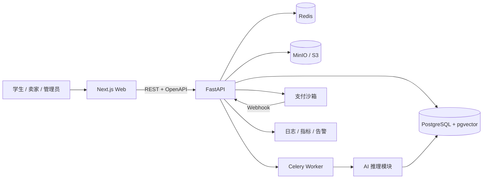

# 校园教材循环｜Campus Book Loop

> 基于校园二手教材业务方案独立实现的参考工程与 AI 实验

## 项目状态

**当前阶段：可运行参考工程 MVP。**

本仓库已将业务材料转化为可实现的软件与 AI 项目，包含 FastAPI 后端、Next.js 前端、SQLite/PostgreSQL 数据层、Alembic 迁移、按时间切分的合成估价与推荐评估、数据卡片与授权记录、种子数据、接口与端到端测试、请求 ID 日志、登录失败限流、安全响应头、管理后台审核/退款 UI、Docker 开发/生产编排和 HTTPS 部署配置。订单已修复“取消/退款后无法再次下单”的约束缺陷。开发编排已在本机实际启动，API 健康检查通过；公网 Demo 仍未上线。项目仍没有真实交易数据或经过真实数据验证的模型，README 中标注为“计划”的能力不代表已经完成。

本项目不继承原方案团队的软件源码或技术成果，不对原方案中的用户规模、交易额、合作配置和模型效果作真实性声明。所有可公开验证的指标都应由本仓库的代码、测试、实验记录和演示环境产生。

## 项目简介

校园二手教材交易通常同时面临三个问题：

- 教材版本、课程和专业信息分散，学生难以确认应购买哪一本；
- 二手书品相和价格差异大，人工定价缺乏透明依据；
- 校园交易缺少统一的发布、检索、履约和售后流程。

`Campus Book Loop` 将建设一个面向校园教材循环的参考实现，围绕“教材发现—发布—估价—推荐—交易—售后”形成最小业务闭环，并把二手书定价和课程匹配作为核心 AI 实验方向。

项目更关注以下问题，而不是完整复制商业计划：

1. AI 能力能否被转化为稳定、可解释的产品功能；
2. 数据不足、冷启动和预测偏差如何处理；
3. 订单、支付沙箱、权限和审计如何设计；
4. 模型指标、工程质量与产品价值如何被验证；
5. 技术选择、限制和业务取舍如何被清晰表达。

## 产品范围

### P0：作品集必须完成

| 模块 | 能力 | 状态 |
| --- | --- | --- |
| 教材库 | 书名、ISBN、作者、出版社、版次、课程、专业和课程编码 | 已实现 |
| 书籍发布 | 品相、说明、价格、卖家关联和图片上传；图片存本地卷，S3/MinIO 待接入 | MVP |
| 智能检索 | 关键词与课程筛选；pgvector 语义检索待接入 | MVP |
| AI 估价 | 规则基线、合成数据 Ridge 模型、价格区间和因素解释 | MVP |
| 推荐 | 内容相似、同课程、供给活跃度和可解释理由；热门/内容/混合三种策略的合成离线评估 | MVP 基线 + 合成评估 |
| 订单闭环 | 创建、幂等、支付沙箱、取消、交接完成、管理员退款；仅允许一个非终态订单，取消/退款后可重新下单 | MVP |
| 管理后台 | 指标、书籍审核表（下架/恢复）、订单退款表和审计事件 | MVP 已实现 |
| 工程交付 | 种子数据、接口测试、Alembic 迁移、OpenAPI 类型生成、Playwright、请求 ID 日志、CI、Docker 和生产编排 | 已实现 |
| 部署与演示 | 开发/生产 Docker Compose、Caddy HTTPS 配置和部署文档；公网 Demo 未上线 | 配置完成，未上线 |

### P1：完成 P0 后继续

- 基于图片的书籍品相辅助识别；
- 开学季、毕业季和库存变化驱动的动态定价；
- PWA 或微信小程序；
- 校园自提点与交接二维码；
- 模型漂移监控和人工复核工作台；
- 更细粒度的推荐解释与冷启动策略。

### 明确不在首版范围内

- 真实资金托管或自建支付账户；
- 未经授权采集真实学生信息或对接真实教务系统；
- 依赖网页抓取京东、当当、知网等平台的脆弱数据管线；
- 面向全国高校的实时运营系统；
- 没有数据集和评估依据的“高准确率”图像鉴别模型。

## 技术栈

目标技术栈采用“模块化单体 + 独立后台任务 + 可替换 AI 模块”的结构。下表区分**首版实际使用**与**计划/目标**，避免把规划中的技术误认为已实现。

| 层次 | 首版实际使用 | 计划或目标 |
| --- | --- | --- |
| Web | Next.js 16、React 19、TypeScript、Tailwind CSS | shadcn/ui、TanStack Query |
| 数据请求 | 手写 fetch 客户端 + OpenAPI 生成类型 | OpenAPI Client |
| API | Python 3.12、FastAPI、Pydantic 2 | — |
| ORM 与迁移 | SQLAlchemy 2、Alembic | — |
| 数据库 | PostgreSQL（pgvector 镜像，仅用关系表）；测试用 SQLite | pgvector 语义召回与全文检索 |
| 缓存与队列 | 无 | Redis、Celery |
| 价格模型 | 规则基线 + 标准库闭式 Ridge | scikit-learn、LightGBM、Optuna |
| 推荐 | 内容二元组相似、同课程、供给活跃度 | Item-CF、pgvector 召回、排序模型 |
| 文本模型 | 字符二元组余弦 | sentence-transformers、BGE-small-zh |
| OCR | 无 | PaddleOCR、浏览器条形码识别 |
| 文件存储 | API 本地卷 + `/media` 静态访问 | MinIO / S3 兼容存储 |
| 支付 | 内部沙箱状态流转 | 支付宝/微信支付沙箱回调 |
| 可观测性 | 请求 ID、标准日志 | structlog、Prometheus、Sentry、集中日志 |
| 测试 | pytest、httpx、Playwright | 覆盖率门槛、更多异常路径 |
| 部署 | Docker Compose、Caddy 配置、GitHub Actions 配置 | 远端 CI 首次通过、公网 Demo |

### 关键技术决策

- **使用 PostgreSQL 替代原方案中的 MySQL**：业务数据、全文检索与 `pgvector` 可以在一个数据库内完成，降低首版部署和数据同步成本。
- **采用模块化单体**：用户、教材、交易、AI 和管理模块保持清晰边界，等实际负载出现后再拆分服务。
- **先规则后模型**：智能估价首先实现透明的规则基线，再用 LightGBM 比较误差，避免把业务公式包装成 AI。
- **使用支付沙箱**：重点展示订单状态机、Webhook 幂等和退款流程，不声称具备资金托管资质。
- **模型可替换**：推理通过稳定接口封装，训练脚本不直接依赖 Web 框架，方便离线评估和模型升级。

## 系统架构



主要领域：

- `catalog`：课程、专业、教师、教材和 ISBN；
- `listing`：书籍发布、品相、图片和状态；
- `pricing`：规则定价、模型估价、价格区间和人工复核；
- `recommendation`：候选召回、排序、冷启动和解释；
- `order`：支付沙箱、交接、退款、纠纷和幂等；
- `moderation`：内容审核、违规处置和审计；
- `identity`：演示账号、角色和权限；
- `analytics`：行为日志、漏斗和实验指标。

## AI 实验设计

### 1. 二手教材智能估价

定价模型的目标是给出可解释的价格区间，而不是只返回一个不可验证的数字。

| 项目 | 设计 |
| --- | --- |
| 输入 | 新书价、品相、版次、笔记密度、课程热度、供需、季节和专业 |
| 基线 | 标准化手册中的规则定价公式 |
| 候选模型 | 合成实验使用闭式 Ridge；真实数据阶段计划 LightGBM 或分位数回归 |
| 输出 | 建议售价、价格上下限、主要影响因素 |
| 指标 | MAE、MAPE、R²、预测区间覆盖率和分组误差 |
| 防泄漏 | 排除成交价、成交时间等交易后信息；按时间切分训练与测试集 |

### 2. 教材混合推荐

| 项目 | 首版实现 | 计划 |
| --- | --- | --- |
| 召回 | 内容相似、同课程、供给活跃度 | 热门、pgvector 向量、Item-CF 多路召回 |
| 排序 | 规则加权（内容 0.35、同课程 0.25、课程筛选 0.2、活跃度 0.1、可负担性 0.1） | LightGBM 排序或融合模型 |
| 冷启动 | 课程、专业和内容相似度 | 新用户/新课程专项策略 |
| 指标 | 合成数据的 Recall@10、NDCG@10、覆盖率 | 真实行为数据、冷启动命中率和多样性 |
| 可解释性 | 显示“同课程”“教材内容相近”“供给最活跃”等理由 | 更细粒度贡献说明 |

合成数据评估比较了热门、内容、混合三种策略：混合策略 Recall@10 为 0.5867、NDCG@10 为 0.3510，热门基线分别为 0.3767 和 0.1757。交互数据由课程偏好规则生成，内容方法天然占优，不能作为真实推荐质量。结果与边界见[推荐评估](docs/evaluation-recommender.md)，原始指标见 `docs/evaluation-recommender.json`。

当前合成数据结果见[评估结果](docs/evaluation-results.md)。规则基线在 MAE 和 MAPE 上优于 Ridge 模型，说明该生成过程与规则高度同构，不能据此宣称模型具有真实业务优势。真实数据实验规范见[评估文档](docs/evaluation.md)，模型卡已按合成结果回填：[模型卡](docs/model-card.md)。

复现两条合成实验：

```bash
python ml/train_price_model.py
python ml/evaluate_recommender.py
```

## 数据策略

首版使用三类数据，并在仓库中明确标记来源：

1. **公开或授权数据**：教材基础信息、开放图书数据和经授权的课程教材关系；
2. **手工种子数据**：用于保证 Demo 可重复的教材、用户和订单；
3. **合成交互数据**：只用于验证推荐与估价管线，必须标记为合成数据。

数据规则：

- 不提交真实姓名、学号、身份证、联系方式、家庭经济材料或校内账号；
- 不使用未经授权的教务系统数据；
- 不提交缺少公开与再分发许可的数据集；
- 训练、验证和测试集有明确版本与划分策略；
- 演示数据与实验结果有可追溯的数据清单；
- 上传图片中的人脸、票据和个人笔记在公开前完成清理。

当前数据集、字段、真实/合成比例、授权记录和真实数据接入检查表见[数据卡片](docs/data-card.md)。合成估价的训练/验证按发布时间切分，推荐按逐用户最后一次交互留出；真实数据仍需重新执行切分与泄漏检查。

## 隐私与安全

数据分类、日志脱敏、图片边界和删除机制见[隐私说明](docs/privacy.md)；越权、令牌泄露、订单重放、恶意上传等威胁与现有控制见[威胁模型](docs/threat-model.md)。两文均标注尚未实现的缺口，不能替代上线前需要的隐私影响评估。

## 当前目录结构

当前主要代码结构：

```text
campus-book-loop/
├── apps/
│   ├── web/                 # Next.js 学生端、卖家端、管理后台与 Playwright 用例
│   └── api/                 # FastAPI 应用、Alembic 迁移、种子数据和接口测试
├── ml/
│   ├── README.md
│   ├── train_price_model.py # 可复现的合成数据估价实验
│   └── evaluate_recommender.py # 热门/内容/混合推荐离线评估
├── docs/
│   ├── evaluation.md
│   ├── evaluation-results.md
│   ├── evaluation-results.json
│   ├── evaluation-recommender.md
│   ├── evaluation-recommender.json
│   ├── deployment.md        # 单机生产部署、备份与恢复
│   ├── data-card.md         # 数据集、字段、授权记录与切分
│   ├── privacy.md           # 数据分类、日志与删除边界
│   ├── threat-model.md      # 威胁、控制与缺口
│   └── model-card.md
├── deploy/
│   └── Caddyfile           # HTTPS 与反向代理
├── scripts/                 # API、Web、OpenAPI 导出和种子数据脚本
├── .github/workflows/
├── .env.example
├── .env.prod.example
├── docker-compose.yml
├── docker-compose.prod.yml
├── MODIFICATION_PLAN.md
└── README.md
```

## 本地开发

复制环境变量模板并启动全部容器：

```bash
cp .env.example .env
docker compose up --build
```

容器启动时 API 会先执行 `alembic upgrade head`，再启动服务并写入种子数据。默认只启动 PostgreSQL、API 和 Web；Redis 与 MinIO 当前代码尚未使用，需要时用 `docker compose --profile extras up` 启动。

目标访问地址：

- Web：`http://localhost:3000`
- API 文档：`http://localhost:8000/docs`
- 书籍图片：`http://localhost:8000/media/...`
- MinIO 控制台：`http://localhost:9001`（仅 `--profile extras`；当前图片存本地卷）

不使用容器时，分别启动：

```powershell
.\.venv\Scripts\python.exe -m pip install -e "apps/api[dev]"
cd apps\api
..\..\.venv\Scripts\python.exe -m alembic upgrade head
cd ..\..
.\scripts\run-api.ps1
cd apps\web
npm ci
npm run dev
```

重新导出 API 契约并生成前端类型（修改后端 schema 后必须执行）：

```powershell
python scripts\export-openapi.py
cd apps\web
npm run gen:api-types
```

运行端到端测试（Playwright 会自动启动 API `127.0.0.1:8010` 与 Web `127.0.0.1:3010`，使用内存 SQLite，不污染开发数据库）：

```powershell
cd apps\web
npx playwright install chromium
$env:E2E_PYTHON = "..\..\.venv\Scripts\python.exe"
npm run test:e2e
```

单机生产部署、HTTPS、备份与恢复见 [部署文档](docs/deployment.md)。

演示账号：

- 买家：`student@campus.local` / `DemoPass123!`
- 卖家：`seller@campus.local` / `DemoPass123!`
- 管理员：`admin@campus.local` / `AdminPass123!`

## 工程质量目标

- API 使用 OpenAPI 契约生成前端 TypeScript 类型；
- 订单状态迁移、支付回调与退款处理具备幂等性；
- 关键业务规则拥有单元测试，完整流程拥有端到端测试；
- 所有环境变量通过 `.env` 注入，密钥不进入 Git；
- 数据库结构只通过 Alembic 迁移变更；
- GitHub Actions 执行格式、类型、测试、构建与镜像检查；
- 日志包含请求 ID，但不记录密码、Token、身份证或完整联系方式；
- 在线 Demo 使用单独的低权限账号和明确标注的演示数据。

## 当前验证结果

以下结果来自本轮本地验证：

- 数据库迁移：初始迁移与 `0002_order_active_listing` 的升级、降级、`alembic check` 在 SQLite 上通过；带历史取消订单升级后数据保留，部分唯一索引能阻止重复非终态订单；
- 后端接口测试：`18 passed`，覆盖鉴权、登录失败限流、安全响应头、教材检索、发布、图片上传与静态访问、估价、推荐、订单幂等和状态迁移、取消/退款后重新下单、管理员列表/审核/退款、普通用户越权拒绝、请求 ID；
- 后端质量检查：`ruff check` 与 `mypy` 通过；
- 前端 ESLint、TypeScript 检查：通过；
- Next.js 生产构建：通过，6 个业务页面与错误页完成静态生成；
- OpenAPI 契约：导出文件与 `openapi-typescript` 生成类型稳定，CI 配置了漂移检查；
- Playwright 端到端测试：`6 passed`，覆盖首页估价、买家登录与沙箱下单支付、卖家带图片发布、管理员指标、管理员下架/恢复与 UI 退款、学生越权被拒绝；
- 安全基线：登录失败按账号+来源限制为 5 次/5 分钟，生产环境拒绝弱或默认 `TOKEN_SECRET`，API 返回 `nosniff`、`DENY`、`no-referrer` 和 `no-store`；
- 合成数据实验：估价按发布时间切分（训练截至 2026-06-12，验证从 2026-06-13 开始），规则基线与 Ridge 结果可复现；推荐按逐用户最后一次交互留出，热门/内容/混合三组策略 Recall@10 分别为 0.3767、0.5200、0.5867；
- 数据治理：数据卡片、授权记录、字段清单和真实数据接入检查表已建立，真实数据仍未接入；
- Docker 编排：已在本机执行 `docker compose up --build`，API 健康检查返回 `ok`，PostgreSQL 为 healthy；Web 首页仍需人工确认；
- GitHub Actions：配置已写好，但尚未在远端仓库实际运行；
- 在线 Demo：**尚未部署**。仓库提供部署编排和步骤，但缺少域名、服务器与证书邮箱，未产生公网地址。

## AI 实验可复现标准

每次模型实验至少记录：

- 数据版本、样本量、字段说明和清洗规则；
- 数据切分方式以及防止泄漏的检查；
- 基线、候选模型、超参数和随机种子；
- MAE、MAPE、Recall@10、NDCG@10 等必要指标；
- 分品相、分类别、冷启动和低活跃用户上的误差；
- 失败案例、适用范围、禁止使用场景和下一步改进。

算法岗还需要提交 [模型卡](docs/model-card.md) 和 [评估报告](docs/evaluation.md)；应用岗位还需要提交 API 契约、部署说明、可观测性截图和端到端 Demo。

## 发布验收

仓库公开前必须满足：

- [x] README 只描述真实完成的能力（本轮已逐项核对）；
- [x] 一条命令启动开发环境（`docker compose up --build`）；
- [x] 种子数据可重建演示场景（删除数据库与上传卷后重启即可）；
- [x] P0 核心流程可完整操作（Playwright 主路径 + 本机演示）；
- [x] 估价规则基线、ML 模型和指标可复现；
- [x] 推荐至少有两个基线和一组评估结果（合成数据）；
- [x] 本地后端接口测试、前端 lint、类型检查和生产构建通过；
- [x] 数据库结构由 Alembic 管理，升级、降级和模型一致性已验证；
- [x] 前端类型由 OpenAPI 生成，并配置契约漂移检查；
- [x] Playwright 主路径在本地通过；
- [x] Docker Compose 在本机实际启动，API 健康检查通过（Web 首页待人工确认）；
- [ ] GitHub Actions 在远端仓库首次通过；
- [ ] 在线 Demo 和测试账号可用；
- [x] 隐私、支付沙箱和数据来源说明已补齐（真实数据授权与隐私影响评估待接入时完成）；
- [x] 当前仓库未发现真实个人材料或未授权合同（新增材料仍需继续检查）。

## 下一阶段优先级（按作品集可信度）

排序标准不是“功能多少”，而是评审能否在 5 分钟内验证项目**真实、可运行、可复现**。本轮已完成“数据卡片/授权记录/时间切分”和“订单重复购买缺陷”两项，其余留到下一阶段。

### 第一优先：不做会直接削弱可信度

| 顺序 | 事项 | 为什么影响可信度 | 下一阶段动作 |
| --- | --- | --- | --- |
| 1 | Git 仓库与远端 CI 首次通过 | 当前目录尚未初始化 Git，CI 配置从未真正执行；没有提交历史和绿色流水线，README 的工程质量声明缺少证据 | 初始化 Git、推送远端，让 api、web、contract、e2e 四个 job 全绿，并在 README 放徽章 |
| 2 | 在线 Demo | 评审无法直接体验，只能读代码；截图和本地环境也容易过期 | 准备域名与服务器，按[部署文档](docs/deployment.md)部署，补齐测试账号、数据重置和 Web 首页验证 |
| 3 | 真实数据接入 | 合成数据卡片、授权模板和按发布时间切分已完成；但真实交易与行为数据仍未取得，算法结论仍不能外推 | 确定可用的公开或授权数据，补齐授权记录与隐私影响评估，重跑估价和推荐评估 |
| 4 | 生产部署与恢复演练 | 开发 Compose 已验证，但生产编排、Caddy 证书、备份恢复尚未在真实服务器执行 | 在目标服务器部署，执行备份/恢复和回滚，记录验证结果 |

### 第二优先：显著提升说服力

| 顺序 | 事项 | 为什么影响可信度 | 下一阶段动作 |
| --- | --- | --- | --- |
| 5 | 剩余安全基线 | 登录限流为进程内实现，令牌在 localStorage，无 CSP、集中日志和镜像扫描 | 换共享限流、令牌存储与 CSP，补日志脱敏和依赖/镜像扫描 |
| 6 | 推荐深度 | 只有规则基线和合成评估，缺少 Item-CF、向量召回和冷启动证据 | 接入 pgvector 与 Item-CF 基线，补冷启动和真实行为评估 |
| 7 | 可观测性 | 目前只有请求 ID 和标准日志，没有指标、告警和追踪 | 增加核心路径耗时、错误率、模型版本日志和基础告警 |
| 8 | License 与贡献说明 | 公开仓库没有许可证会限制他人使用，也显得发布未完成 | 选择许可证，补 CONTRIBUTING、Issue 和 PR 模板 |

### 第三优先：有余力再做

| 顺序 | 事项 | 为什么靠后 | 下一阶段动作 |
| --- | --- | --- | --- |
| 9 | 图片品相辅助识别 | 缺少标注数据，过早实现容易变成不可信演示 | 先建标注规范和小样本实验 |
| 10 | 动态定价 | 没有真实曝光和成交数据，收益无法验证 | 等真实数据后再做 |
| 11 | PWA/小程序、自提点二维码、实时聊天 | 与当前核心 AI 和工程能力关系较弱 | 按真实使用反馈决定 |

完成第一优先级后，再回到 [MODIFICATION_PLAN.md](MODIFICATION_PLAN.md) 的 P1/P2。轮次记录和剩余任务以该清单为准。

## 修改与实施

具体任务、优先级、验收标准和实施顺序见 [MODIFICATION_PLAN.md](MODIFICATION_PLAN.md)。

当前工作原则：

1. 先完成可运行闭环，再增加模型复杂度；
2. 先建立基线和评估，再宣传 AI 效果；
3. 先完成隐私和权限控制，再接入公开演示数据；
4. 先保证订单一致性，再扩展跨校、聊天和图像识别；
5. 商业材料只作为需求来源，不作为已实现能力或真实运营证据。

## 与原始业务材料的关系

根目录中的项目报告、问卷和运营材料仅作为业务背景与需求输入。后续整理时应：

- 将可公开的业务背景放入 `docs/business/`，删除无法核实的市场与收益承诺；
- 将品相、定价和售后规则转为代码、枚举、配置和测试；
- 将技术系统说明升级为架构图、ER 图和可运行的数据库迁移；
- 将合作协议视为框架材料，不对外表述为已签署合作；
- 将涉及学生身份、家庭经济情况和真实交易的材料排除在公开仓库之外。

## 已知限制

- 当前源码是独立参考实现，不包含原方案的原始源码；
- 原业务方案中的部分市场数据、问卷数量和商业假设尚未核实；
- 估价模型只使用合成数据，验证结果不能外推到真实市场；
- 由于缺少真实教材图片标注，图像品相识别不作为首版承诺；
- 图片当前存 API 主机本地卷，适用于单机演示；多副本部署需要接入 S3/MinIO 并抽出存储接口；
- 支付、退款和纠纷流程使用沙箱与模拟状态，不代表真实资金清算；
- 教务信息接入使用 CSV 适配器或模拟数据，不代表已获得校方授权；
- 推荐和估价评估都只使用合成数据，结果不能外推到真实学生或真实市场；真实数据尚未接入；
- 登录失败限流是进程内实现，多副本或重启后不共享；验证码、CSP、集中日志、告警、依赖与镜像扫描均未实现；
- 订单部分唯一索引与迁移只在 SQLite 验证，PostgreSQL 实例需在部署环境实测；
- 公网 Demo 尚未部署；开发编排已在本机实际启动，但生产编排、备份恢复和 Caddy 证书尚未在真实服务器验证。

## License

许可证将在公开仓库前确定。第三方数据和代码必须保留各自许可证与来源说明。
